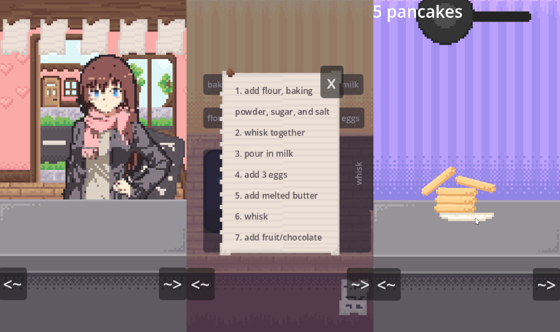

# Pancake Peak 🥞
 A game about stacking pancakes  
 inspired by good pizza great pizza  

 got the idea because the theme is peak  
 so its like its peak hours  for a restaurant  
 and because youre stacking pancakes tall  like a mountain

using godot engine

this is a mobile game where you cook and stack pancakes
currently implemented:
- pancake stacking minigame
- switching between areas
- beautefil pixel arts :3

how to test:  
   download the latest build from releases!!

gameplay:  
there are 4 areas right now
1. **shop counter**:  
   customers will walk up and order pancakes here  
   currently only one customer wating eternaly  
   youll be able to serve pancakes and collect money here  
2. **kitchen**:  
   here you can make pancakes batter
   right now the buttons are there but not functional
   there is a recipe in the corner
3. **stove**:
   this is empty right now
   in future will have a timing based minigame wherer you wait and flip to cook perfectly
4. **serving**:
   here is the first "finished" minigame  
   the pan moves back and forth at the top of the screen
   click or tap to drop the pancake. try to land it on the plate
   no other gameplay yet so just try to get as high score as u can

made for terra
